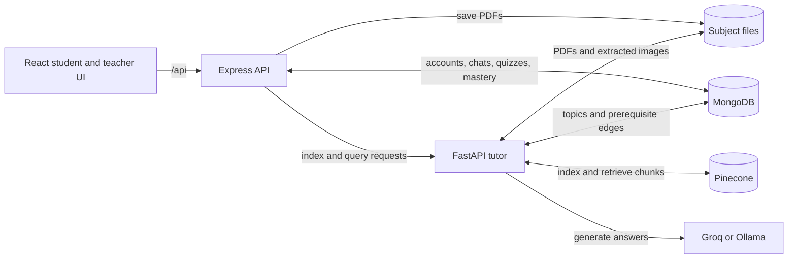

# Architecture

A student question passes through three services. The browser sends the question to Express, which adds the student's saved subject profile. The Python tutor retrieves course material and builds the explanation. Express returns the result and manages the conversation and quiz records.

## From a PDF to a course graph

1. Express checks the teacher's subject assignment, stages the PDF in `uploads/<subject>/documents/`, and records the upload in MongoDB.
2. The document processor reads text by page, extracts qualifying images, chunks the text, computes embeddings, and writes vectors with source metadata to the subject's Pinecone namespace. A content hash helps track indexed files.
3. The prerequisite pipeline extracts candidate topics, merges duplicate names, proposes weighted prerequisite edges, and checks for cycles and redundant links. The results go into MongoDB. Teachers can correct a topic's prerequisites in their workspace.
4. The streaming upload endpoint forwards indexing progress to the teacher's browser. The document list records completion or failure.

Implementation: [upload controller](../backend/controllers/documentController.js), [document processor](../tutor/document_processing/pipeline.py), [prerequisite pipeline](../tutor/prerequisite_processing/pipeline.py), and [graph validation](../tutor/prerequisite_processing/validation.py).

## From a question to an explanation

Express looks up the student's mastery records for the selected subject. It sends the question, chat history, chosen difficulty, model preference, mastered topics, and structured learner profile to `POST /rag/query`.

The tutor searches the subject's indexed passages, identifies a course topic, and looks up its prerequisites. Retained prerequisites can be skipped and decayed ones can be flagged for a refresher. It uses these signals, relevant misconception labels, and the retrieved text to build the generation prompt. The student receives the answer and available source snippets. Document images and generated Mermaid diagrams are separate display options.

Implementation: [query controller](../backend/controllers/queryController.js), [response generator](../tutor/query_processing/response_generator.py), and [prompt builder](../tutor/query_processing/prompt_builder.py).

## From a quiz to the next question

Express scores submitted quiz items and updates the student's per-topic records using Bayesian Knowledge Tracing (BKT). The update uses correct and incorrect observations. An elapsed-time decay function estimates retained mastery at the next assessment or lookup. Wrong choices can contribute a suspected misconception, and strong performance on an advanced topic can reinforce eligible direct prerequisites.

The resulting profile feeds both the mastery dashboard and later query requests. A mastery percentage is the model's estimate for a topic. A quiz score is the observed result on a particular set of questions.

The app's persisted updates run in the [Node quiz service](../backend/services/quizService.js). The tutor also exposes [Python learner-model endpoints](../tutor/main.py) and [learner-model functions](../tutor/learner_modelling/).
